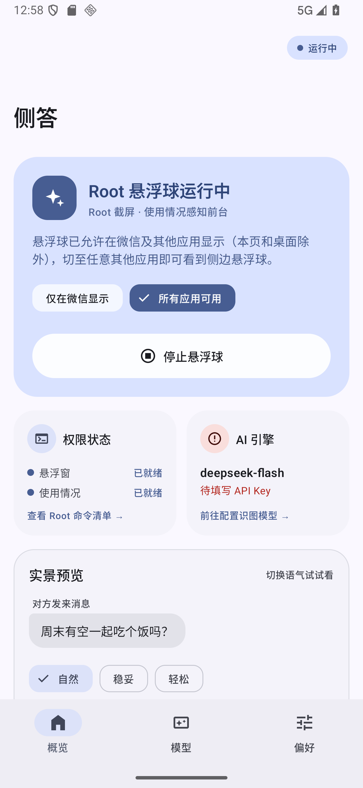
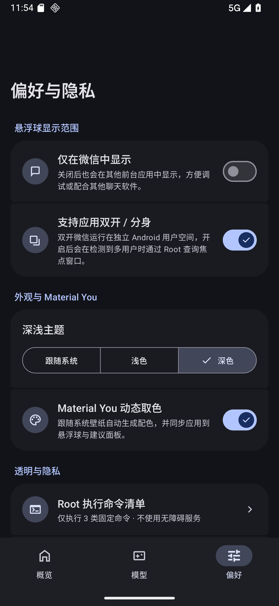
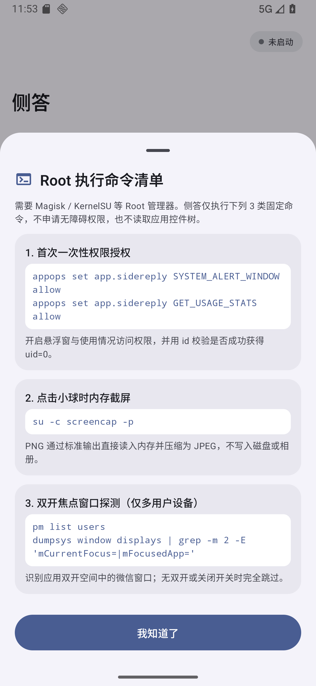

<div align="center">
  

  <h1>渚х瓟 路 SideReply</h1>

  <p>
    <strong>闈㈠悜 Android 11+ 鐨勫井淇?AI 鍥炲鍔╂墜锛圧oot 鐗堬級鈥斺€斿熀浜?Jetpack Compose 涓?Material Design 3锛岄€氳繃鍐呭瓨 Root 鎴睆鐩磋繛瑙嗚澶фā鍨嬶紝闆舵棤闅滅鏈嶅姟銆?/strong>
  </p>

  <p>
    <a href="README.md">绠€浣撲腑鏂?/a> 路
    <a href="README_en.md">English</a>
  </p>

  <p>
    
    
    
    
    
  </p>

  <p>
    <a href="#-highlights">Highlights</a> 路
    <a href="#-screenshots">Screenshots</a> 路
    <a href="#-quick-start">Quick Start</a> 路
    <a href="#-root-commands">Root Commands</a> 路
    <a href="#-model-setup">Model Setup</a> 路
    <a href="#-build--test">Build &amp; Test</a> 路
    <a href="#-architecture">Architecture</a> 路
    <a href="#-license">License</a>
  </p>
</div>

---

## 鉁?Highlights

* **Material Design 3 / Material You 鍏ㄦ柊閲嶆瀯** 鈥?涓荤晫闈㈤噰鐢?M3 `LargeTopAppBar` + 涓夋爣绛?`NavigationBar`锛堟瑙?/ 妯″瀷 / 鍋忓ソ锛夛紝鏀寔娴呰壊銆佹繁鑹层€佽窡闅忕郴缁熷強 Android 12+ 澹佺焊鍔ㄦ€佸彇鑹诧紝骞跺皢涓婚瀹炴椂鍚屾鑷虫偓娴悆涓庢偓娴潰鏉裤€?* **鍙氦浜掔殑姒傝鎺у埗鍙?* 鈥?棣栭〉鎻愪緵鍔ㄦ€佽壊璋冧富鎺уぇ鍗°€佽繍琛屾€佷竴閿垏鎹㈡樉绀鸿寖鍥磋姱鐗囷紙`浠呭湪寰俊鏄剧ず` / `鎵€鏈夊簲鐢ㄥ彲鐢╜锛夈€佹潈闄愪笌 AI 寮曟搸鍙屽垪 Bento 鐘舵€佸崱銆佹敮鎸佸垏鎹㈣姘旂殑瀹炴櫙棰勮锛屼互鍙婇殢鏃跺彲鏌ョ殑 Root 鍛戒护娓呭崟搴曢儴寮圭獥銆?* **闆舵棤闅滅 Root 鍐呭瓨鎴睆** 鈥?涓嶇敵璇?`BIND_ACCESSIBILITY_SERVICE`锛涚偣鍑讳晶杈规偓娴悆鍚庡厛绉婚櫎鑷韩鎮诞绐楋紝鍐嶉€氳繃 `su -c screencap -p` 浠?stdout 璇诲叆鍐呭瓨骞跺帇缂╀负鏈€闀胯竟 1600px 鐨?JPEG锛堜笉鍐欑鐩樸€佷笉鍏ョ浉鍐岋級锛岀洿浼犳敮鎸?`image_url` 鐨勮瑙夋ā鍨嬨€?* **鍙岄噸鍓嶅彴鎰熺煡 + 搴旂敤鍙屽紑鏀寔** 鈥?浠?`UsageStatsManager` 涓轰富璺緞璇嗗埆鍓嶅彴鍖呭悕锛屽湪澶氱敤鎴峰弻寮€璁惧鎴?`UsageStats` 婕忔姤鍒囨崲鏃惰嚜鍔ㄩ€氳繃 Root `WindowFocusProbe`锛坄dumpsys window displays`锛夊厹搴曡瘑鍒富鐢ㄦ埛涓庡垎韬獥鍙ｏ紙濡?`u999`锛夈€?* **Compose M3 鎮诞鐞冧笌寤鸿闈㈡澘** 鈥?鎮诞鐞冩敮鎸佹寜鍘嬬缉鏀句笌鑷姩璐磋竟锛涚偣鍑诲悗鍦?`WindowManager` 涓姞杞?Compose M3 搴曢儴闈㈡澘锛屾彁渚涘彲鎶樺彔澶氳疆 AI 瀵硅瘽璁板綍銆佷笁鑹茶皟寤鸿鍗＄墖銆佽交瑙﹀鍒躲€佸簳閮ㄦ媷鎸囧尯蹇嵎璇皵 `FilterChip` 涓庤嚜瀹氫箟椋庢牸銆屾崲涓€缁勩€嶃€?* **瑙嗚鏈嶅姟棰勮涓庢湰鏈哄瘑閽ュ姞瀵?* 鈥?鍐呯疆 OpenAI銆侀樋閲屼簯閫氫箟銆佹櫤璋?GLM銆並imi 涓庢湰鍦拌皟璇?Mock 蹇嵎棰勮锛汚PI Key 閲囩敤 Android Keystore `AES/GCM/NoPadding` 鍔犲瘑瀛樺偍锛屽苟绂佺敤浜戝浠戒笌鏄庢枃 HTTP锛堟湰鍦拌皟璇曞洖鐜櫎澶栵級銆?
---

## 馃摳 Screenshots

<p align="center">
  
  
  
</p>

---

## 馃殌 Quick Start

1. **瀹夎 APK**锛氫粠 [Releases](https://github.com/arlo-rin/ocr_chat/releases) 涓嬭浇鎴栨寜涓嬫柟姝ラ浠庢簮鐮佺紪璇戝畨瑁?Debug APK锛堥渶 **Android 11+** 涓庡彲鐢ㄧ殑 Root 绠＄悊鍣紝濡?Magisk / KernelSU锛夈€?2. **鍚姩鎮诞鐞?*锛氭墦寮€銆屼晶绛斻€嶏紝鍦?**姒傝** 椤电偣鍑?**`鍚姩鎮诞鐞僠**銆傞娆″惎鍔ㄧ己灏戞潈闄愭椂锛屼晶绛斾細璇锋眰 Root 骞堕€氳繃 `appops` 鑷姩鎺堜簣 `SYSTEM_ALERT_WINDOW` 涓?`GET_USAGE_STATS`锛堝凡鏈夋潈闄愭椂涓嶅啀寮圭獥璇锋眰 Root锛夈€?3. **閰嶇疆瑙嗚妯″瀷**锛氬垏鎹㈠埌 **妯″瀷** 椤碉紝鐐归€夐《閮ㄩ璁撅紙鎴栧～鍐欏吋瀹?OpenAI `POST /chat/completions` 鐨勫湴鍧€銆佹ā鍨嬩笌 API Key锛夛紝鐐瑰嚮 **`淇濆瓨璁剧疆`** 鍚庡啀鐢?**`娴嬭瘯杩炴帴`** 楠岃瘉銆?4. **鍦ㄥ井淇′腑浣跨敤**锛氭墦寮€寰俊鑱婂ぉ鐣岄潰锛堟偓娴悆鍦ㄣ€屼晶绛斻€嶆湰椤典笌妗岄潰浼氳嚜鍔ㄩ殣钘忥紱濡傞渶鍦ㄥ叾浠栧簲鐢ㄨ皟璇曪紝鍙湪姒傝椤电偣 **`鎵€鏈夊簲鐢ㄥ彲鐢╜**锛夛紝杞荤偣渚ц竟鎮诞鐞冨嵆鍙湪搴曢儴 M3 闈㈡澘涓竴閿鍒跺缓璁紱鎯虫崲璇皵鍙偣閫夊簳閮ㄩ鏍兼爣绛炬垨杈撳叆瑕佹眰鍚庣偣 **`鎹竴缁刞**銆?
> **娉ㄦ剰**锛氳鍔″繀閰嶇疆**鏀寔鍥剧墖杈撳叆锛坄image_url`锛夌殑瑙嗚妯″瀷**銆俙娴嬭瘯杩炴帴` 浠呭彂閫佺畝鐭函鏂囨湰楠岃瘉鍦板潃涓庡瘑閽ワ紝鑻ユ墍閫夋ā鍨嬩笉鏀寔鍥剧墖锛岄娆＄偣鍑绘偓娴悆璇嗗浘鏃朵細杩斿洖 400 閿欒鎻愮ず銆?
---

## 馃攼 Root Commands

渚х瓟涓嶅惎鍔ㄥ父椹?root shell锛屼篃涓嶆嫾鎺ョ敤鎴疯緭鍏ュ埌鍛戒护涓紝鎵€鏈?Root 鎿嶄綔鍥哄畾涓轰互涓嬩笁绫伙紙鍙湪 App 鍐?**鍋忓ソ 鈫?Root 鎵ц鍛戒护娓呭崟** 鏌ョ湅锛夛細

| 鍦烘櫙 | 鎵ц鍛戒护 | 璇存槑 |
| --- | --- | --- |
| 棣栨鏉冮檺鎺堟潈 | `appops set app.sidereply SYSTEM_ALERT_WINDOW allow`<br>`appops set app.sidereply GET_USAGE_STATS allow`<br>`id` | 浠呭綋缂哄皯鎮诞绐楁垨浣跨敤鎯呭喌鏉冮檺鏃惰皟鐢紝`id` 鐢ㄤ簬鏍￠獙 `uid=0`銆?|
| 鐐瑰嚮鎮诞鐞冩埅灞?| `su -c screencap -p` | PNG 缁?stdout 璇诲叆鍐呭瓨骞跺嵆鏃惰В鐮佸洖鏀讹紝涓嶈惤鐩橈紙鍏煎 `su 0 sh -c`锛夈€?|
| 鐒︾偣绐楀彛鎺㈡祴 | `pm list users`<br>`dumpsys window displays \| grep -m 6 -E 'mCurrentFocus=\|mFocusedApp='` | 浠呭湪澶氱敤鎴峰弻寮€璁惧鎴?`UsageStats` 鏈崟鑾峰簲鐢ㄥ垏鎹㈡椂瑙﹀彂锛岃嚜鍔ㄨ繃婊?`=null` 鍓睆琛屻€?|

---

## 馃 Model Setup

璇锋眰閲囩敤 OpenAI 鍏煎鏍煎紡锛岃嚜鍔ㄨ鑼冨寲 Base URL 涓?`/chat/completions` 璺緞銆備负淇濋殰闅愮锛屼粎鍏佽 `https://` 涓庢湰鏈鸿皟璇曞湴鍧€锛坄10.0.2.2`銆乣localhost`銆乣127.0.0.1`锛夛細

| 鏈嶅姟棰勮 | 鎺ュ彛鍦板潃 | 瑙嗚妯″瀷绀轰緥 |
| --- | --- | --- |
| OpenAI | `https://api.openai.com/v1/chat/completions` | `gpt-4o-mini` |
| 闃块噷浜戦€氫箟锛堣瑙夛級 | `https://dashscope.aliyuncs.com/compatible-mode/v1/chat/completions` | `qwen-vl-plus` |
| 鏅鸿氨 GLM锛堣瑙夛級 | `https://open.bigmodel.cn/api/paas/v4/chat/completions` | `glm-4v-flash` |
| Moonshot / Kimi锛堣瑙夛級 | `https://api.moonshot.cn/v1/chat/completions` | `moonshot-v1-8k-vision-preview` |
| 鏈湴璋冭瘯 Mock锛堟ā鎷熷櫒锛?| `http://10.0.2.2:8787/v1/chat/completions` | `mock-chat` |

### 鏈湴 Mock 鏈嶅姟璋冭瘯

浠撳簱鍐呯疆闆朵緷璧栨祴璇曟湇鍔?[tools/mock-ai-server.js](tools/mock-ai-server.js)锛屽彲鍦ㄦ棤 API Key 鏃惰皟璇?UI 涓庢埅鍥句笂浼犳祦绋嬶紙婕旂ず鑱婂ぉ椤?`http://10.0.2.2:8787/demo`锛夛細

```powershell
node tools/mock-ai-server.js
```

---

## 馃洜锔?Build & Test

* **鏋勫缓宸ュ叿閾?*锛欰GP `9.4.1` 路 Gradle `9.6.0` 路 Kotlin Compose Compiler `2.2.10` 路 `compileSdk = 37` 路 `minSdk = 30` 路 `targetSdk = 36` 路 JDK `17+`
* 璇风‘淇濇牴鐩綍 `local.properties` 涓?`sdk.dir` 鎸囧悜鏈満 Android SDK銆?
```powershell
# 杩愯 JVM 鍗曞厓娴嬭瘯
.\gradlew.bat :app:testDebugUnitTest

# 杩愯 Android Lint
.\gradlew.bat :app:lintDebug

# 缂栬瘧 Debug APK
.\gradlew.bat :app:assembleDebug

# 瀹夎鍒板凡杩炴帴鐨勮澶囨垨妯℃嫙鍣?adb install -r .\app\build\outputs\apk\debug\app-debug.apk
```

---

## 馃П Architecture

```text
app/src/main/java/app/sidereply/
鈹溾攢鈹€ MainActivity.kt                      Compose 鍏ュ彛銆佸墠鍙扮姸鎬佽拷韪€丷oot 鎺堟潈涓庤繛鎺ユ祴璇?鈹溾攢鈹€ ai/
鈹?  鈹溾攢鈹€ AiClient.kt                      OpenAI 鍏煎 HttpURLConnection 瀹㈡埛绔紙鍚?image_url 璇锋眰浣擄級
鈹?  鈹溾攢鈹€ AiErrorMessages.kt               缃戠粶涓庢帴鍙ｉ敊璇腑鏂囨彁绀烘槧灏?鈹?  鈹溾攢鈹€ EndpointNormalizer.kt            Base URL 鑷姩琛ュ叏涓?HTTPS/鍥炵幆瀹夊叏鏍￠獙
鈹?  鈹溾攢鈹€ Models.kt                        AiConfig / ReplySuggestion / AiException
鈹?  鈹溾攢鈹€ ProviderPresets.kt               涓绘祦瑙嗚澶фā鍨嬮璁句笌 host 鍖归厤
鈹?  鈹溾攢鈹€ ReplyParser.kt                   JSON / 浠ｇ爜鍧?/ 绾枃鏈瀹硅В鏋?鈹?  鈹斺攢鈹€ ReplyPrompts.kt                  銆屾垜銆嶅彂閫佽€呰瑙掗攣瀹氥€佹寚瀹氶鏍间笌鎹竴缁勬彁绀鸿瘝
鈹溾攢鈹€ data/
鈹?  鈹溾攢鈹€ AppPreferences.kt                SharedPreferences 灏佽锛堟樉绀鸿寖鍥淬€佸弻寮€銆佷富棰樻ā寮忋€佸姩鎬佸彇鑹诧級
鈹?  鈹斺攢鈹€ SecretStore.kt                   Android Keystore AES-GCM 鍔犺В瀵?鈹溾攢鈹€ root/
鈹?  鈹溾攢鈹€ RootManager.kt                   appops 鎺堟潈涓庢潈闄愭鏌?鈹?  鈹溾攢鈹€ RootShell.kt                     su 鍛戒护鎵ц涓?stdout 鍐呭瓨鎴睆
鈹?  鈹斺攢鈹€ WindowFocusProbe.kt              dumpsys window 鐒︾偣绐楀彛瑙ｆ瀽锛堝灞忎笌鍙屽紑鍏煎锛?鈹溾攢鈹€ service/
鈹?  鈹斺攢鈹€ FloatingAssistantService.kt      鍓嶅彴鏈嶅姟銆乁sageStats/Root 鍓嶅彴璇嗗埆銆丮3 鎮诞鐞冧笌 Compose 鎮诞绐?鈹斺攢鈹€ ui/
    鈹溾攢鈹€ SheetRootLayout.kt               鎮诞绐楁牴瑙嗗浘锛堟嫤鎴郴缁熻繑鍥為敭鍏抽棴闈㈡澘锛?    鈹溾攢鈹€ icons/SideReplyIcons.kt          Material Symbols 椋庢牸鐭㈤噺鍥炬爣闆?    鈹溾攢鈹€ main/
    鈹?  鈹溾攢鈹€ MainUiState.kt               涓荤晫闈㈡爣绛句笌閰嶇疆鐘舵€?    鈹?  鈹溾攢鈹€ SideReplyApp.kt              M3 Scaffold / LargeTopAppBar / NavigationBar / 寮圭獥
    鈹?  鈹溾攢鈹€ HomeTab.kt                   姒傝椤碉紙涓绘帶鍗°€佽寖鍥村垏鎹㈣姱鐗囥€丅ento 鐘舵€佸崱銆佸疄鏅瑙堬級
    鈹?  鈹溾攢鈹€ ModelTab.kt                  妯″瀷椤碉紙棰勮鑺墖銆佹牎楠岃〃鍗曘€佸瘑閽ユ樉绀?娓呴櫎銆佽繛鎺ユ祴璇曪級
    鈹?  鈹斺攢鈹€ SettingsTab.kt               鍋忓ソ椤碉紙鍒嗙粍鍦嗚鍗＄墖銆佹繁娴呬富棰樸€佸姩鎬佸彇鑹层€侀殣绉佽鏄庯級
    鈹溾攢鈹€ sheet/
    鈹?  鈹溾攢鈹€ OverlayLifecycleOwner.kt     WindowManager 鎮诞绐楀唴宓?Compose 鐢熷懡鍛ㄦ湡瀹夸富
    鈹?  鈹溾攢鈹€ ReplySheetUiState.kt         鎮诞闈㈡澘澶氳疆瀵硅瘽涓庨樁娈电姸鎬?    鈹?  鈹斺攢鈹€ ReplySheetContent.kt         Compose M3 搴曢儴寤鸿闈㈡澘銆佸璇濊褰曚笌蹇嵎椋庢牸鏍?    鈹斺攢鈹€ theme/
        鈹溾攢鈹€ Color.kt                     Material 3 娴呰壊 / 娣辫壊 HCT 鑹叉澘
        鈹溾攢鈹€ Shape.kt                     M3 褰㈢姸涓庡垎缁勫渾瑙掕鑼?        鈹溾攢鈹€ Type.kt                      M3 鎺掔増灞傜骇
        鈹斺攢鈹€ Theme.kt                     SideReplyTheme锛堟敮鎸佸姩鎬佸彇鑹蹭笌瀹夊叏鍥為€€锛?```

---

## 鈿狅笍 Notes & Permissions

* **澹版槑鏉冮檺**锛歚INTERNET`銆乣SYSTEM_ALERT_WINDOW`銆乣PACKAGE_USAGE_STATS`銆乣FOREGROUND_SERVICE`銆乣FOREGROUND_SERVICE_SPECIAL_USE`銆乣POST_NOTIFICATIONS`锛?*鏃?`BIND_ACCESSIBILITY_SERVICE`**锛屼笉鐢宠瀛樺偍銆佺浉鏈恒€侀€氳褰曟垨寮€鏈鸿嚜鍚潈闄愩€?* **闅愮涓庡畨鍏?*锛氭暣寮犳埅鍥句粎鍦ㄥ唴瀛樹腑鍘嬬缉涓?JPEG 鍚庡彂閫佽嚦浣犻厤缃殑 AI 鏈嶅姟锛屽叧闂潰鏉垮嵆閲婃斁鍐呭瓨寮曠敤锛涜嫢褰撳墠鑱婂ぉ绐楀彛寮€鍚簡 `FLAG_SECURE`锛岀郴缁熸埅灞忓彲鑳借繑鍥為粦灞忋€?* **鍏嶈矗澹版槑**锛氭湰椤圭洰涓轰釜浜哄伐鍏峰師鍨嬶紝涓嶉毝灞炰簬鑵捐/寰俊鎴栦换浣?Root 绠＄悊鍣紱浣跨敤 Root 鏉冮檺涓庣涓夋柟瑙嗚妯″瀷鍓嶈鑷瀹￠槄婧愮爜骞惰瘎浼板璇濋殣绉併€?
---

## 馃搫 License

鏈」鐩熀浜?[GNU General Public License v3.0](LICENSE) 寮€婧愩€?