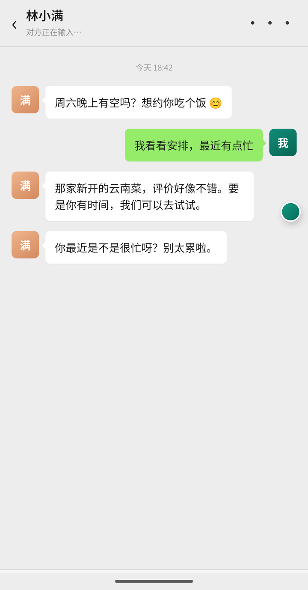
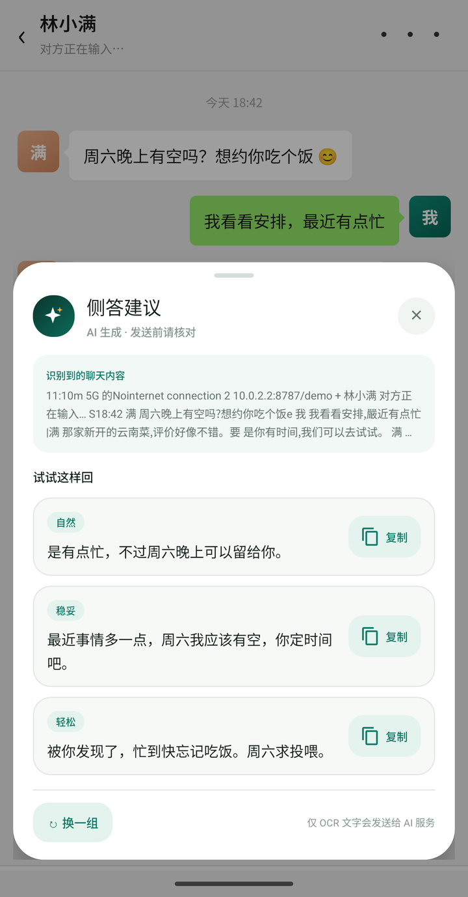

# 侧答 · SideReply（Root 版）

> 在微信里点一下侧边小球，侧答通过 Root 截屏看懂当前聊天，递给你三条能直接发的回复。

「侧答」是一个 Android 11+ 的微信回复助手原型。**它不使用无障碍服务**。它依赖你已经 Root 的手机，通过 Root 一次性授权悬浮窗与使用情况访问，用 UsageStats 判断微信是否在前台，点击小球时通过 `su -c screencap` 获取当前屏幕，把截图压缩成 JPEG 直接交给**支持识图的模型**（OpenAI 兼容的 `image_url`），由模型自己看懂聊天并回三条可以直接发的话。应用内不做 OCR，也不打包任何识别模型。

<p align="center">
  
</p>

<p align="center">
  
</p>

| 微信里的侧边悬浮球 | 点击后得到三条回复建议 |
| --- | --- |
|  |  |

## 现在能做什么

- **不使用无障碍**：Manifest 中没有 `BIND_ACCESSIBILITY_SERVICE`，也没有注册 AccessibilityService。
- **只在微信出现**：通过 UsageStats 判断前台 Activity，默认仅监听微信（`com.tencent.mm`），离开微信自动隐藏；可关闭此限制用于调试或其它聊天软件。
- **支持应用双开 / 应用分身**：双开副本跑在另一个 Android 用户里，UsageStats 看不到它。检测到多用户时，侧答会用 Root 读一次 `dumpsys window` 的焦点窗口来判断前台，双开微信里同样出现小球；没有多用户的手机会完全跳过这一步，不额外耗电。
- **极简悬浮球**：可见直径 28dp 的绿色圆点，外圈 2dp 纯白描边，不显示文字；外层保留 48dp 透明触摸区域。可拖动，松手自动吸附到左侧或右侧；使用 `TYPE_APPLICATION_OVERLAY` 悬浮窗。
- **点一下完成识别**：点击后先移除悬浮层，再通过 Root 执行 `screencap -p`，因此截图里不会混入侧答自己的 UI；截图通过 stdout 读入内存，不写入磁盘。
- **截图直传识图模型**：截图缩到最长边 1600、压成 JPEG（约 200–400 KB），作为 `image_url`（`data:image/jpeg;base64,…`）随请求发出，由模型判断每条消息是谁发的、该回什么。面板顶部会显示这次上传的大小。
- **和 AI 的对话记录**：点下小球后，面板顶部立刻出现这一轮的“我：发送了聊天截图 · 320 KB，请你生成回答”，紧接着是“AI：正在看图，想 3 个接法…”；拿到回复后变成“已生成 3 条回复，见下方 ↓”，下面就是那三张带复制按钮的卡片。点「换一组」会再追加一轮，之前的轮次保留完整的三条回复，方便对比不同风格——所以记录不会重复最新那三条。
- **没有本地 OCR**：APK 里不再包含 ML Kit 或任何识别模型（体积从约 53 MB 降到约 3 MB），也不需要 Google Play 服务。代价是必须配置一个能吃图片的接口，模型不支持时一般返回 400。
- **可指定风格**：回复面板里有「指定回复风格」输入框，例如输入“严谨”“温柔”“更简短”，点旁边的「换一组」或键盘完成键，三条都会按该风格重新生成；留空则使用默认的「自然 / 稳妥 / 轻松」。指定风格只改变语气，不会改变“我发给对方”的视角。
- **三条可直接发送的建议**：调用任意 OpenAI 兼容的 `chat/completions` 接口，点一下复制；提示词强制以截图手机主人（“我”）的身份写给对方，不会主动切换成对方口吻。
- **换一组保持视角**：重新生成时会把上一轮的三条建议一起带给模型，要求“换 3 条新表达、仍由我发给对方”，既避免重复，也避免换成对方视角；同一张截图留在内存里复用，不用重新截屏。
- **可换一组、可重试**：网络失败、截图失败、接口不支持图片都有明确状态和恢复入口。
- **API Key 本机加密**：Android Keystore AES-GCM，本机保存；关闭云备份与设备迁移。
- **前台服务**：有常驻通知，便于确认悬浮球服务仍在运行；点「停止悬浮球」立即移除悬浮层并结束通知。

## 安装 / 快速开始

### 直接安装体验

`dist/SideReply-0.4.2-root-debug.apk` 是调试签名 APK（约 3 MB，不再包含任何 OCR 模型），适合个人手机直接安装测试。

> 需要 **Android 11+**、可用的 **Root（Magisk / KernelSU 等）**，以及一个**支持图片输入**的 OpenAI 兼容接口。没有 Root 的手机可以安装，但悬浮层无法完成截屏。

### 首次使用

1. 安装 APK。
2. 打开「侧答」，在 **01 · 启动 Root 悬浮球** 点「启动悬浮球」。
3. Root 管理器会弹出授权请求；允许后，侧答通过 Root 执行两条 `appops`：
   - `SYSTEM_ALERT_WINDOW allow`（显示悬浮窗）
   - `GET_USAGE_STATS allow`（判断前台应用）
4. 允许通知权限（Android 13+）。随后出现「侧答正在运行」的前台通知和「运行中」状态。
5. 在 **02 · 连接 AI** 填写接口、模型和 API Key，点「测试连接」确认，保存。
6. 打开微信聊天界面，屏幕侧边出现「AI」小球；点一下，等模型看完截图，在底部面板里复制建议。想换语气时，在建议上方的风格框输入“严谨 / 温柔 / 更简短”等再点旁边「换一组」。
7. 长按小球可拖动，松手后自动贴边；面板可点右上角 × 或空白处关闭。

> 如果启动时悬浮窗/使用情况权限已经存在，侧答不会为授权重复请求 Root；Root 会在第一次截图时被调用（或由 Root 管理器复用已有授权）。

### 从源码构建

前置条件：

- Android Studio（本项目使用 AGP 9.4.1 / Gradle 9.6.0）
- Android SDK Platform 37（`compileSdk = 37`）
- JDK 17 或更高（本机用 JDK 25 验证）
- 运行时没有任何第三方推理依赖，构建基本可离线完成

Windows PowerShell：

```powershell
# 把 JAVA_HOME 换成你的 JDK / Android Studio JBR
$env:JAVA_HOME = "$env:LOCALAPPDATA\Programs\Android Studio\jbr"

.\gradlew.bat :app:assembleDebug
adb install -r .\app\build\outputs\apk\debug\app-debug.apk
```

macOS / Linux：

```bash
./gradlew :app:assembleDebug
adb install -r app/build/outputs/apk/debug/app-debug.apk
```

`local.properties` 需要指向你本机的 Android SDK，Android Studio 首次打开项目时会自动生成；仓库里的文件仅供本机使用，已在 `.gitignore` 中排除。

## Root 具体做了什么

侧答不会启动常驻 root shell，也不会执行用户输入的命令。应用通过 `su` 执行以下有限命令：

1. 首次启动时：
   ```sh
   appops set app.sidereply SYSTEM_ALERT_WINDOW allow
   appops set app.sidereply GET_USAGE_STATS allow
   id
   ```
   其中 `id` 仅用于确认当前确实以 `uid=0` 执行。
2. 每次点击小球截图时：
   ```sh
   su -c screencap -p
   ```
   截图的 PNG 通过 stdout 读取进内存，随后马上解码并回收；不经过相册，不落盘。
3. 前台检测（仅当系统存在第二个 Android 用户，即手机开了「应用双开 / 应用分身」时）：
   ```sh
   pm list users
   dumpsys window displays | grep -m 2 -E 'mCurrentFocus=|mFocusedApp='
   ```
   `pm list users` 只在服务启动时执行一次，用来确认确实有双开空间；焦点窗口大约每 1.8 秒查询一次（小球显示中时降到 5 秒），`grep -m 2` 会让 dumpsys 在输出这两行后立刻被 SIGPIPE 结束，成本远低于完整 dump。双开支持可以在「03 · 使用偏好」里关掉，关掉后不再执行这两条命令。

`su -c` 是 Magisk/KernelSU 的标准形式；同时兼容部分 AOSP userdebug 镜像的 `su 0 sh -c` 形式。

## 前台检测与生命周期

- 前台服务（`specialUse` 类型）持有通知和悬浮窗，退出侧答页面后继续运行。
- 每 900ms 通过 `UsageStatsManager.queryEvents` 读取最近一次 `ACTIVITY_RESUMED`，更新当前前台包名。
- 系统存在多用户（双开空间）且未关闭「在双开 / 分身应用中显示」时，额外用 Root 读取全局焦点窗口；它覆盖另一个用户里的窗口，因此双开微信也能被识别。`UsageStats` 仍是主路径，焦点查询只是补齐它看不到的用户。
- 只有当前台是微信（含双开副本，或关闭「仅在微信中显示」后的其它应用，桌面除外）且屏幕已解锁时，才显示小球。
- 锁屏、黑屏、打开侧答设置页时自动隐藏；停止服务或进程被杀时移除所有 overlay。
- 应用不申请开机自启；手机重启或强制停止应用后，需要重新打开侧答并启动服务。

## 配置 AI 接口

侧答只要求接口兼容 OpenAI 的 `POST /chat/completions`，请求体使用 `model`、`messages`、`temperature`、`max_tokens`、`stream: false`，并且 `user` 的 `content` 是 `[{type:"text"},{type:"image_url"}]` 数组。

**必须选择支持图片输入的模型**，否则接口会返回 400：

| 服务 | 接口地址（Base URL 或完整地址） | 模型示例 |
| --- | --- | --- |
| OpenAI | `https://api.openai.com/v1/chat/completions` | `gpt-4o-mini`、`gpt-4.1-mini` |
| 阿里云百炼 / 通义（视觉） | `https://dashscope.aliyuncs.com/compatible-mode/v1/chat/completions` | `qwen-vl-max`、`qwen-vl-plus` |
| 智谱 GLM（视觉） | `https://open.bigmodel.cn/api/paas/v4/chat/completions` | `glm-4v-flash`、`glm-4v-plus` |
| Moonshot / Kimi（视觉） | `https://api.moonshot.cn/v1/chat/completions` | `moonshot-v1-8k-vision-preview` |
| 自建 Ollama（模拟器） | `http://10.0.2.2:11434/v1/chat/completions` | `llama3.2-vision` |
| DeepSeek（**仅文本**） | `https://api.deepseek.com` | 不支持图片输入，本项目已不再适用 |

注意事项：

- 接口地址可以填 **Base URL** 或完整的 `/chat/completions` 地址。侧答会自动补全路径，保存/测试后输入框会显示最终使用的完整地址。
- 「测试连接」发的是纯文本请求（只验证地址、模型名和 Key），它**不能**验证模型是否支持图片；真正的识图能力要第一次点小球才会用到。
- 为保护 API Key，除以下本地调试地址外只允许 HTTPS：`10.0.2.2`、`localhost`、`127.0.0.1`。其它 HTTP 地址会被拒绝。真机连接局域网自建服务时，请配置 HTTPS；也可以使用 `adb reverse tcp:8787 tcp:8787` 后填 `http://127.0.0.1:8787/...`。
- 「测试连接」会真实调用一次接口，消耗少量 token。
- 无鉴权的本地服务可以留空 API Key；缺 Key 时侧答会提示先配置，不会盲目发起请求。

## 隐私与安全

- **离开手机的内容**：**整张聊天截图（压缩后的 JPEG，约 200–400 KB）会发送到你配置的 AI 服务**，由模型识别。应用内没有 OCR，所以不存在“只上行文字”的模式；对隐私敏感的场景请勿使用。
- **截图处理**：Root 截图的 PNG 通过 stdout 进入内存，解码后压缩、回收，不写入相册、缓存文件或日志；同一轮「换一组」复用内存里的那一份 JPEG。
- **API Key**：AES-GCM 加密后保存在应用私有 SharedPreferences，密钥由 Android Keystore 管理；不写日志、不写入 APK。`allowBackup=false`，并额外通过 `data_extraction_rules.xml` 排除云备份和设备迁移。
- **明文网络**：默认拒绝；仅对模拟器/本机回环地址开放 HTTP，便于开发调试。
- **Root 权限**：Root 能执行任意命令，因此请只给可信应用授权。侧答源码中的 root 命令是固定字符串，不接受网络输入拼接；仍建议自行审阅 [RootShell.kt](app/src/main/java/app/sidereply/root/RootShell.kt) 和 [RootManager.kt](app/src/main/java/app/sidereply/root/RootManager.kt) 后再授权。
- **敏感对话**：截图可能包含昵称、头像、地址等；图片发出去前请自行判断。请勿在支付、身份证件、密码或高度私密的聊天中使用。
- **不含遥测**：应用自身没有埋点或分析 SDK，也没有本地识别模型，唯一的外部依赖就是你自己配置的接口。

## 权限说明

| 权限 | 用途 |
| --- | --- |
| `INTERNET` | 调用用户配置的 AI 接口 |
| `SYSTEM_ALERT_WINDOW` | 显示悬浮球和回复面板 |
| `PACKAGE_USAGE_STATS` | 通过 UsageStats 判断微信/当前前台应用 |
| `FOREGROUND_SERVICE` + `FOREGROUND_SERVICE_SPECIAL_USE` | 在退出侧答页面后保持悬浮服务运行 |
| `POST_NOTIFICATIONS` | 显示「侧答正在运行」的常驻通知 |
| **无 `BIND_ACCESSIBILITY_SERVICE`** | **不使用无障碍服务** |
| 无存储 / 相机 / 通讯录 / 短信 | 不读取、不保存这些数据 |

Root 授权时通过 `appops` 开启的悬浮窗和使用情况权限，不依赖用户手动进入系统设置。

## 项目结构

```text
app/src/main/java/app/sidereply/
├── MainActivity.kt                 设置、Root 启动/停止、连接测试
├── data/
│   ├── AppPreferences.kt           用户配置 + 加密后的 Key
│   └── SecretStore.kt              Android Keystore AES-GCM
├── ai/
│   ├── AiClient.kt                 OpenAI 兼容 HTTP 客户端 + 图片请求体
│   ├── AiErrorMessages.kt          错误到中文提示的映射
│   ├── EndpointNormalizer.kt       Base URL / 完整地址补全与校验
│   ├── Models.kt                   AiConfig / ReplySuggestion / AiException
│   ├── ReplyParser.kt              宽容的 JSON / 纯文本回复解析
│   └── ReplyPrompts.kt             识图提示词（发送者视角约束）
├── root/
│   ├── RootManager.kt              appops 授权、权限状态
│   ├── RootShell.kt                su 执行 + root screencap
│   └── WindowFocusProbe.kt         焦点窗口解析（双开空间同样可见）
├── service/
│   └── FloatingAssistantService.kt 前台服务、悬浮球、UsageStats、截图、AI 调度
└── ui/
    ├── MaxHeightScrollView.kt      小屏可滚动的回复区
    └── SheetRootLayout.kt          面板根布局
```

资源：

```text
res/layout/activity_main.xml        设置首页
res/layout/view_reply_sheet.xml     悬浮回复面板
res/layout/item_reply_suggestion.xml 单条建议
res/xml/data_extraction_rules.xml   禁止备份敏感配置
res/xml/network_security_config.xml
```

## 开发与测试

```powershell
# JVM 单元测试（回复解析器、接口地址补全、提示词视角/换一组约束）
.\gradlew.bat :app:testDebugUnitTest

# Lint
.\gradlew.bat :app:lintDebug

# Debug APK
.\gradlew.bat :app:assembleDebug
```

本次 Root 版在 Android 16（API 36）x86_64 模拟器上验证了：

- 移除无障碍后正常安装；Manifest 中没有 AccessibilityService
- 通过 adb 模拟 Root 的 appops，首页识别为「悬浮权限已就绪」
- 点击启动后前台服务启动，通知和「运行中」状态正常
- 打开 Chrome 后 UsageStats 检测前台变化，悬浮球出现在 Chrome 上
- 点击小球在没有 `su` 的环境下给出「Root 截图失败：未找到 su」错误面板，没有崩溃
- 停止悬浮球后前台服务结束、通知消失、悬浮层移除
- 请求体单元测试确认 `user.content` 是 `[text, image_url]` 两段，`image_url` 的 base64 能还原成原始 JPEG，风格与「换一组」上一轮建议都进入了 text 段
- 焦点窗口解析单元测试覆盖主用户、双开用户（`u999`）、`mFocusedApp` 优先于临时弹窗、空焦点与无关输出
- 提示词单元测试确认「我」的发送者视角、禁止对方口吻、换一组会携带上一轮建议，并要求模型自己按截图判断谁说了什么
- 自定义风格提示词测试确认“严谨”等风格会应用到三条回复，且不能改变发送者身份

**当前测试环境没有可用的 `su`（Google APIs 模拟器无法把 su 执行权限授予 app），所以完整的「Root 截图 → 识图模型 → 三条建议」链路需要在你的已 Root 真机上验收。** 模拟器上的测试使用 `adb shell appops set ...` 代替 Root 授权步骤。

### 本地 mock AI 服务

仓库自带一个零依赖 Node.js mock，用于在没有真实 API Key 时验证 UI 和网络链路：

```powershell
node tools/mock-ai-server.js
```

- 模拟器接口地址：`http://10.0.2.2:8787/v1/chat/completions`
- 模型：任意，例如 `mock-chat`
- Key：`test-key` 或留空
- 演示聊天页：`http://10.0.2.2:8787/demo`

mock 会接受带图片的请求（上限 4 MB），日志里会打印 `imageKB=`，方便确认截图确实发出去了；它不真的看图，固定返回三条演示建议。

> mock 服务监听 `0.0.0.0` 且不校验 Key，仅用于本机开发；不要暴露到公网。

## 已知限制

- 仅支持 Android 11+。
- 需要可用的 Root 管理器；如果 `su` 被拒绝、被隐藏或不在 PATH 中，截图会失败并显示原因。
- **必须使用支持图片输入的模型**：侧答不再做 OCR，接口若不支持 `image_url` 会返回 400（应用会提示“确认这是支持图片输入的模型”）。「测试连接」是纯文本请求，验不出这一点。
- 识图质量取决于模型：小字、深色主题、密集群聊的稳定性因模型而异；图片请求的 token 与费用通常明显高于纯文本，个别接口还有请求体大小限制（侧答把截图压到最长边 1600、JPEG 质量 82，一般 200–400 KB）。
- 某些深度定制系统可能限制 `appops` 或 `screencap`；遇到权限问题时请检查 Root 管理器日志。
- 双开支持依赖系统把双开空间登记成额外的 Android 用户（小米/OPPO/vivo/华为的「应用双开 / 应用分身」都符合，`pm list users` 里能看到 999 之类的用户）。如果双开是用第三方分身 App 做的，前台包名会变成分身 App 自己，侧答无法分辨里面开的是哪个应用——这时请关掉「仅在微信中显示」，让小球在分身 App 里也常驻。
- 双开支持开启后，服务会周期性（约 1.8 秒 / 显示中 5 秒）用 Root 读一次焦点窗口，比纯 UsageStats 略增耗电；关掉开关后立刻停止这些查询。检测到多用户的判断只在服务启动时做一次，新开双开应用后需要重启一次悬浮球。
- 如果微信页面被系统标记为安全窗口，截图可能全黑，模型自然读不到聊天内容。
- 截图里包含状态栏、标题栏、输入框等界面噪声，提示词要求模型聚焦聊天内容，但复杂背景/表情仍可能影响结果。
- 当前只发送当前屏幕，不会滚动聊天记录；一次只生成一轮建议，没有历史会话和流式输出。
- 不自动发送，也不自动粘贴；复制后由用户手动发送。
- 应用不申请开机自启；手机重启或强制停止应用后，需要重新打开侧答并启动服务。
- 前台服务通知在用户拒绝通知权限时可能只出现在系统任务管理器中。
- 在 Android 16 模拟器上，系统返回键不会优先交给悬浮面板；请使用面板的 × 或点击空白处关闭。
- 调试 APK 使用 debug 签名，不适合长期分发；正式发布请创建自己的签名并使用 release 构建。

## 下一步可做

- 根据用户所在 ROM 增加 Root 授权诊断（检测 su 路径、SELinux、appops 输出）。
- 为「自然 / 稳妥 / 轻松」之外增加自定义语气和关系设定。
- 支持流式响应、缓存最近几轮建议。
- 增加更多识图模型预设（OpenAI / 通义 / GLM / Kimi）与一键切换。
- 在明确用户手势确认的前提下，研究“复制并跳回微信”的体验（仍然不自动发送）。

## 说明

- 本项目是一个可运行的个人工具原型，不隶属于腾讯或微信，也不隶属于任何 Root 管理器。
- Root 会扩大应用权限边界，请在使用前审阅源码并自行承担风险。
- AI 生成的回复需要用户自行核对后再发送。
