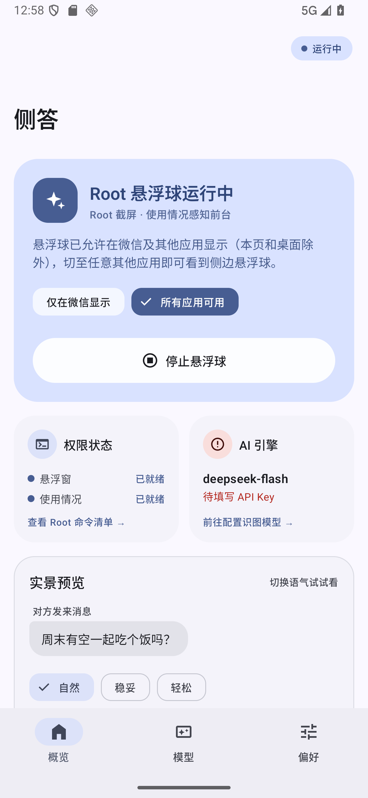
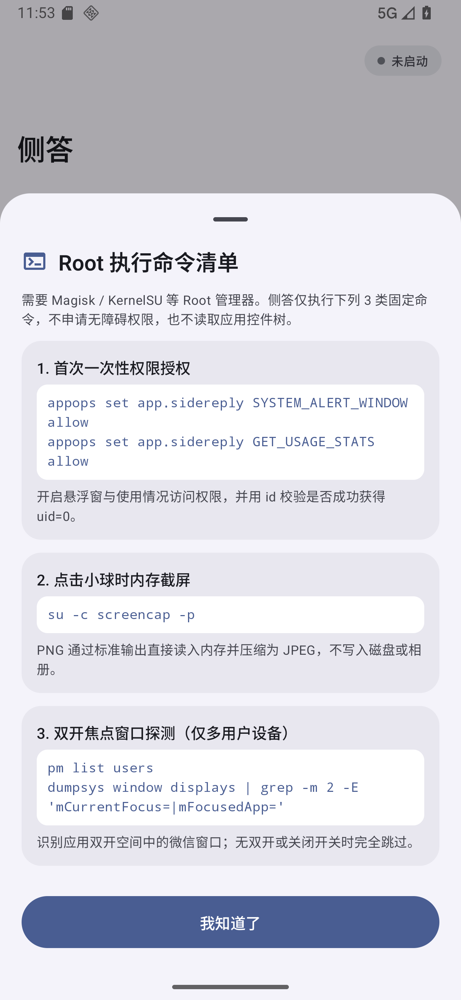

<div align="center">
  

  <h1>SideReply 路 渚х瓟</h1>

  <p>
    <strong>A Root-powered AI reply assistant for WeChat on Android 11+ 鈥?built with Jetpack Compose &amp; Material Design 3, sending in-memory root screenshots directly to vision models with zero Accessibility Services.</strong>
  </p>

  <p>
    <a href="README.md">绠€浣撲腑鏂?/a> 路
    <a href="README_en.md">English</a>
  </p>

  <p>
    
    
    
    
    
  </p>

  <p>
    <a href="#-highlights">Highlights</a> 路
    <a href="#-screenshots">Screenshots</a> 路
    <a href="#-quick-start">Quick Start</a> 路
    <a href="#-root-commands">Root Commands</a> 路
    <a href="#-model-setup">Model Setup</a> 路
    <a href="#-build--test">Build &amp; Test</a> 路
    <a href="#-architecture">Architecture</a> 路
    <a href="#-license">License</a>
  </p>
</div>

---

## 鉁?Highlights

* **Material Design 3 & Material You** 鈥?Redesigned with an M3 `LargeTopAppBar` and a three-tab `NavigationBar` (Overview / Model / Settings), supporting Light, Dark, System themes, and Android 12+ dynamic wallpaper color synced live to the floating orb and reply sheet.
* **Interactive Overview Dashboard** 鈥?Features a state-aware hero control card, one-tap visibility scope chips (`WeChat Only` / `All Apps`), dual Bento status cards for permissions & AI engine, an interactive tone-switching reply preview, and a transparent Root commands bottom sheet.
* **Zero-Accessibility In-Memory Root Capture** 鈥?Declares no `BIND_ACCESSIBILITY_SERVICE`; tapping the floating orb temporarily hides the overlay, runs `su -c screencap -p` into memory, scales to max 1600px JPEG (never written to disk or gallery), and sends it directly to any vision-capable `image_url` model.
* **Hybrid Foreground Detection + Dual-App Support** 鈥?Primarily tracks foreground apps via `UsageStatsManager`, and automatically falls back to Root `WindowFocusProbe` (`dumpsys window displays`) on multi-user clone devices (e.g., `u999`) or whenever `UsageStats` misses an app switch.
* **Compose M3 Floating Orb & Reply Sheet** 鈥?Draggable 34dp floating orb with press scaling and edge snapping; tapping opens a Compose M3 overlay bottom sheet with an expandable multi-round AI conversation log, three tonal suggestion cards, one-tap copy, and a thumb-zone style refinement bar.
* **Provider Presets & On-Device Key Encryption** 鈥?Built-in presets for OpenAI, Alibaba Qwen VL, Zhipu GLM, Moonshot Kimi, and local mock debugging; API keys are encrypted via Android Keystore `AES/GCM/NoPadding` with cloud backup and cleartext HTTP disabled (except loopback hosts).

---

## 馃摳 Screenshots

<p align="center">
  
  
  
</p>

---

## 馃殌 Quick Start

1. **Install the APK**: Download from [Releases](https://github.com/arlo-rin/ocr_chat/releases) or build from source below (requires **Android 11+** and a working Root manager such as Magisk or KernelSU).
2. **Start the Floating Orb**: Open SideReply and tap **`鍚姩鎮诞鐞僠** (Start Floating Orb) on the **Overview** tab. If permissions are missing, SideReply automatically grants `SYSTEM_ALERT_WINDOW` and `GET_USAGE_STATS` via `appops` through Root (subsequent starts skip Root if already granted).
3. **Configure a Vision Model**: Open the **Model** tab, pick a preset or enter an OpenAI-compatible `POST /chat/completions` endpoint, vision model name, and API key, then tap **`淇濆瓨璁剧疆`** (Save) and **`娴嬭瘯杩炴帴`** (Test Connection).
4. **Use in WeChat**: Switch to a WeChat chat screen (the orb automatically hides inside SideReply itself and on the launcher; tap **`鎵€鏈夊簲鐢ㄥ彲鐢╜** on the Overview card if you want to test in other apps). Tap the floating orb, wait for vision analysis, tap any suggestion to copy, or pick a tone chip and regenerate.

> **Important**: You must choose a **vision-capable model supporting `image_url`**. The built-in connection test sends a short text-only prompt to verify endpoint, model name, and key; if your model does not accept images, the endpoint will return HTTP 400 when tapping the orb.

---

## 馃攼 Root Commands

SideReply never keeps a persistent root shell open and never interpolates user input into shell commands. All Root invocations are fixed in code and inspectable inside the app under **Settings 鈫?Root Commands**:

| Purpose | Command | Details |
| --- | --- | --- |
| One-time Permission Setup | `appops set app.sidereply SYSTEM_ALERT_WINDOW allow`<br>`appops set app.sidereply GET_USAGE_STATS allow`<br>`id` | Executed only if overlay or usage access is missing; `id` verifies `uid=0`. |
| In-Memory Screenshot | `su -c screencap -p` | PNG bytes are read from stdout into memory, compressed to JPEG, and recycled (also supports `su 0 sh -c`). |
| Focus Window Probe | `pm list users`<br>`dumpsys window displays \| grep -m 6 -E 'mCurrentFocus=\|mFocusedApp='` | Triggered only when dual-space users exist or `UsageStats` has not reported a switch; skips `=null` secondary displays. |

---

## 馃 Model Setup

Requests follow the OpenAI Chat Completions contract, normalizing base URLs automatically. Only `https://` endpoints and local loopback hosts (`10.0.2.2`, `localhost`, `127.0.0.1`) are permitted:

| Preset | Endpoint | Sample Vision Model |
| --- | --- | --- |
| OpenAI | `https://api.openai.com/v1/chat/completions` | `gpt-4o-mini` |
| Alibaba Qwen (Vision) | `https://dashscope.aliyuncs.com/compatible-mode/v1/chat/completions` | `qwen-vl-plus` |
| Zhipu GLM (Vision) | `https://open.bigmodel.cn/api/paas/v4/chat/completions` | `glm-4v-flash` |
| Moonshot / Kimi (Vision) | `https://api.moonshot.cn/v1/chat/completions` | `moonshot-v1-8k-vision-preview` |
| Local Mock (Emulator) | `http://10.0.2.2:8787/v1/chat/completions` | `mock-chat` |

### Local Mock Server

A zero-dependency Node.js mock server is included at [tools/mock-ai-server.js](tools/mock-ai-server.js) for UI and upload testing without an API key (includes a demo chat page at `http://10.0.2.2:8787/demo`):

```powershell
node tools/mock-ai-server.js
```

---

## 馃洜锔?Build & Test

* **Toolchain**: AGP `9.4.1` 路 Gradle `9.6.0` 路 Kotlin Compose Compiler `2.2.10` 路 `compileSdk = 37` 路 `minSdk = 30` 路 `targetSdk = 36` 路 JDK `17+`
* Ensure `local.properties` points `sdk.dir` to your local Android SDK.

```powershell
# Run JVM unit tests
.\gradlew.bat :app:testDebugUnitTest

# Run Android Lint
.\gradlew.bat :app:lintDebug

# Build Debug APK
.\gradlew.bat :app:assembleDebug

# Install onto connected device or emulator
adb install -r .\app\build\outputs\apk\debug\app-debug.apk
```

---

## 馃П Architecture

```text
app/src/main/java/app/sidereply/
鈹溾攢鈹€ MainActivity.kt                      Compose entry, foreground tracking, Root setup & connection test
鈹溾攢鈹€ ai/
鈹?  鈹溾攢鈹€ AiClient.kt                      OpenAI-compatible HttpURLConnection client with image_url payload
鈹?  鈹溾攢鈹€ AiErrorMessages.kt               Error-to-message mapper
鈹?  鈹溾攢鈹€ EndpointNormalizer.kt            Base URL normalization & HTTPS/loopback validation
鈹?  鈹溾攢鈹€ Models.kt                        AiConfig / ReplySuggestion / AiException
鈹?  鈹溾攢鈹€ ProviderPresets.kt               Vision provider presets & host matcher
鈹?  鈹溾攢鈹€ ReplyParser.kt                   Lenient JSON / fenced block / plain-text parser
鈹?  鈹斺攢鈹€ ReplyPrompts.kt                  Sender-perspective ("I") constraint & style/regeneration prompts
鈹溾攢鈹€ data/
鈹?  鈹溾攢鈹€ AppPreferences.kt                SharedPreferences wrapper (scope, dual-app, theme mode, dynamic color)
鈹?  鈹斺攢鈹€ SecretStore.kt                   Android Keystore AES-GCM encryption
鈹溾攢鈹€ root/
鈹?  鈹溾攢鈹€ RootManager.kt                   appops permission grants & readiness checks
鈹?  鈹溾攢鈹€ RootShell.kt                     su execution & stdout in-memory screenshot capture
鈹?  鈹斺攢鈹€ WindowFocusProbe.kt              dumpsys window focus parser (multi-display & dual-space)
鈹溾攢鈹€ service/
鈹?  鈹斺攢鈹€ FloatingAssistantService.kt      Foreground service, UsageStats/Root probing, M3 orb & Compose sheet
鈹斺攢鈹€ ui/
    鈹溾攢鈹€ SheetRootLayout.kt               Overlay root container handling system Back events
    鈹溾攢鈹€ icons/SideReplyIcons.kt          Material Symbols vector icon set
    鈹溾攢鈹€ main/
    鈹?  鈹溾攢鈹€ MainUiState.kt               Main screen tabs & form state
    鈹?  鈹溾攢鈹€ SideReplyApp.kt              M3 Scaffold / LargeTopAppBar / NavigationBar / dialogs
    鈹?  鈹溾攢鈹€ HomeTab.kt                   Overview tab (hero control, scope chips, Bento cards, live preview)
    鈹?  鈹溾攢鈹€ ModelTab.kt                  Model tab (provider presets, validation, key controls, test action)
    鈹?  鈹斺攢鈹€ SettingsTab.kt               Settings tab (grouped cards, theme controls, privacy & Root sheet)
    鈹溾攢鈹€ sheet/
    鈹?  鈹溾攢鈹€ OverlayLifecycleOwner.kt     Lifecycle/SavedState/ViewModelStore owner for Service ComposeView
    鈹?  鈹溾攢鈹€ ReplySheetUiState.kt         Overlay sheet rounds & phase state
    鈹?  鈹斺攢鈹€ ReplySheetContent.kt         Compose M3 reply bottom sheet, chat log & style bar
    鈹斺攢鈹€ theme/
        鈹溾攢鈹€ Color.kt                     Material 3 Light / Dark HCT palettes
        鈹溾攢鈹€ Shape.kt                     M3 shapes & grouped card corner tokens
        鈹溾攢鈹€ Type.kt                      M3 typography scale
        鈹斺攢鈹€ Theme.kt                     SideReplyTheme (dynamic color with safe fallback)
```

---

## 鈿狅笍 Notes & Permissions

* **Permissions**: `INTERNET`, `SYSTEM_ALERT_WINDOW`, `PACKAGE_USAGE_STATS`, `FOREGROUND_SERVICE`, `FOREGROUND_SERVICE_SPECIAL_USE`, `POST_NOTIFICATIONS`. **No `BIND_ACCESSIBILITY_SERVICE`**, and no storage, camera, contacts, or boot-completed permissions.
* **Privacy & Security**: Full-screen JPEG snapshots exist only in memory during the request and are cleared when the sheet closes; screens marked `FLAG_SECURE` may capture black frames.
* **Disclaimer**: Personal utility prototype, not affiliated with Tencent/WeChat or any Root manager. Review the source code before granting Root privileges and verify AI replies before sending.

---

## 馃搫 License

Licensed under the [GNU General Public License v3.0](LICENSE).
